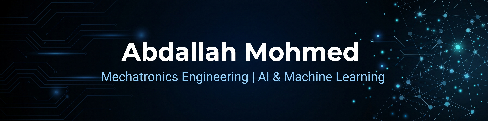
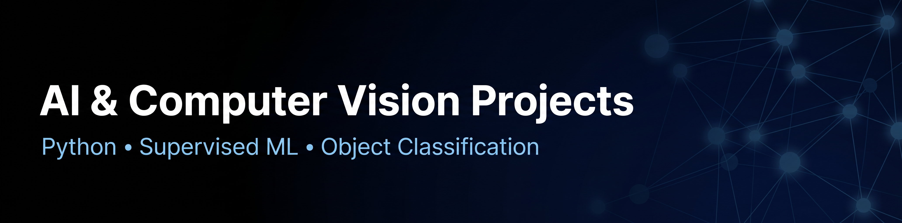
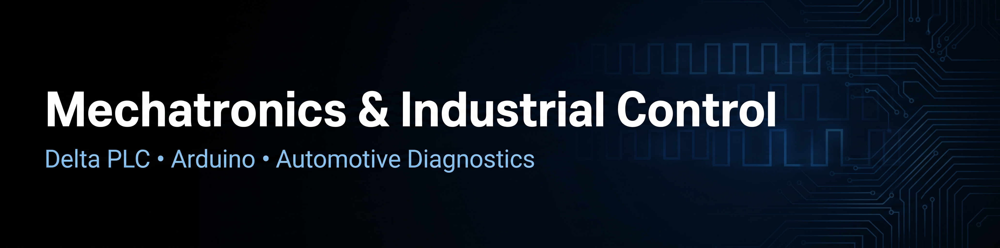

  

<h2>🧑‍💻 About Me</h2>

  4th-year <strong>Mechatronics Technology &amp; Engineering</strong> student at Helwan International Technological University, currently building my foundation in <strong>Python</strong>, <strong>Machine Learning</strong>, and <strong>Computer Vision</strong>. Combining hands-on experience in industrial automation, embedded systems, and automotive diagnostics with a growing focus on intelligent, data-driven software.

  
  

<h2>🛠️ Tech Stack &amp; Engineering Tools</h2>

<strong>🐍 AI, Machine Learning &amp; Programming (Current Focus)</strong>

  
  
  
  
  

<strong>⚙️ Mechatronics, Control &amp; Design (Core Background)</strong>

  
  
  
  

<h2>🤖 AI &amp; Computer Vision Learning Projects</h2>

Building practical foundations in supervised learning (regression &amp; classification) using Python and Jupyter, alongside a real-time image classification model trained to recognize vehicles (cars, buses) and everyday objects.

<h2>🏭 Mechatronics &amp; Industrial Control</h2>

Hands-on PLC programming (Delta SX2 via ISPSoft &amp; DOPSoft), DC motor control prototyping (Arduino &amp; L298N), and 198 hours of practical electrical/mechanical maintenance and control diagnostics at Nissan El-Saba Autoservice.

